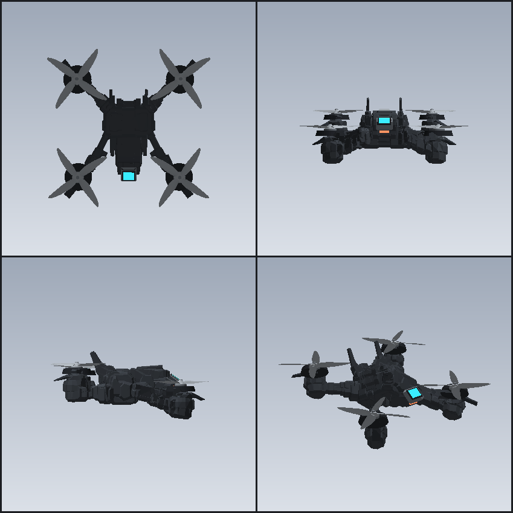

# Descrycraft


## 导航

- [README.md](README.md) — English
- [README.zh-Hans.md](README.zh-Hans.md) — 简体中文

针对 Minecraft 1.21.1 + NeoForge 的监视工具集 —— 可部署的远程摄像与模块化侦查无人机。此 README 以侦查无人机（参考实现）为主。



## 快速概览

- **侦查无人机** — 可驾驶的远程相机，带链距约束（已发布）。
- **计划中** — 针孔摄像机、观看终端、运动传感器、追踪标签。
- **设计要点** — 统一的链距/信号模型、统一 HUD（"visor"）、模块化工作台、服务端权威、资产由 `tools/` 生成。

## 功能（无人机）

- 每名玩家最多一个已部署的无人机。
- 远程驾驶：第一人称相机，HUD 显示位置、距离、机体生命值与按键提示。
- 信号模型：画面随距离劣化；默认链距 64 方块，可通过信号模块扩展。
- 标记：锥形视野内且有直视的生物由服务端标记，客户端负责渲染。
- 模块：通过 Module Workbench 安装（Recon Boost、Container Marker、Alert Radar、Signal 等）。
- 电池：**没装电池就没有可用画面**——画面全糊、方向无法操控，模块也一律不生效。电量附着在物品上。
- 攻击：可选武装（一次性）；爆炸与伤害在服务端校验与处理。
- 客户端视觉：信号模糊、HUD；着色器位于 `assets/descrycraft/shaders/`。

## 默认按键（可重绑定）

- 右键方块 — 在该面上部署无人机
- 右键空中 / G — 投掷无人机
- 潜行 + 右键无人机 — 收回无人机
- 潜行 + 右键（持电池）— 装/卸电池
- V — 链接 / 解除链接（进入/退出无人机视图）
- R — 召回无人机
- W A S D / 空格 / Shift — 飞行控制
- C — 翻滚（点按：一圈；长按：连续旋转）
- 冲刺（飞行时 + Attack Module）— 冲锋攻击
- X（飞行时 + Attack Module）— 引爆战斗装置

按键可在 Options → Controls → Recon Drone 中修改。

## 命令

- `/descrycraft doorinteract [true|false]` — 切换驾驶时是否能开门
- `/descrycraft dimension` — 显示记录的/当前维度及召回守护状态

## 模块（概要）

在 Module Workbench 中：左槽放无人机，中央放板（board），右槽输出已装配的无人机。

- **Drone Customization Module** — 开启装配槽（必需）
- **Recon Boost Module** — 扩大扫描锥与距离，并解锁依赖它的板
- **Container Marker Module** — 标记附近容器
- **Alert Radar Module** — 在拥有者周围警告生物与玩家
- **Signal Module I / II** — 扩展链距（每级 +32）
- **Attack Module** — 允许冲锋攻击与引爆
- **Governor Removal Module** — 提高巡航上限

模块前置条件由工作台与服务端强制执行。

## 电池

- **Copper Battery** — 25%（约 12.5 分钟）
- **Graphite Battery** — 100%（约 50 分钟）
- 消耗速率：每 600 tick 消耗 1%（服务端计时）

电量保存在 ItemStack 上：部署、收回、被击落后都随物品返回。

## 网络与服务端权威

- 运动由客户端驱动，但服务端做校验（所有权、每 tick 步进上限、链距、碰撞检测）。
- 标记、容器扫描、门交互、冲锋攻击与伤害由服务端决定；客户端只发送意图请求，服务端决定结果并下发给拥有者。
- 模块行为与传感器结果由服务端生成并发送给相应玩家，客户端只负责渲染。

## 资源与生成

- 大部分模型与纹理由 `tools/` 下的 Python 脚本生成（仅使用标准库）。
- 着色器为手写文件，位于 `assets/descrycraft/shaders/`（post 链与 fragment 程序）。
- 常用脚本：
  - `tools/generate_drone_mesh.py` — 生成 OBJ/MTL 与清单
  - `tools/prepare_drone_model.py` — 把 Blender 导出的模型转成项目资产；见
    [`docs/model-pipeline.md`](docs/model-pipeline.md)
  - `tools/generate_textures.py` — 生成 PNG（实体纹理、图标、GUI）
  - `tools/verify_mesh.py`、`tools/verify_shaders.py` — 验证器
  - `tools/preview_*` — 离线渲染预览

修改着色器或模型后请运行验证脚本。

## 构建与开发

要求：JDK 21。

```bash
./gradlew build         # 生成 build/libs/Descrycraft-<version>.jar
./gradlew runClient     # 启动开发客户端
./gradlew runServer     # 启动开发服务端
```

资产流水线：

```bash
python tools/verify_mesh.py
python tools/verify_shaders.py
python tools/preview_mesh.py    # 生成 build/preview/drone-preview.png
```

模型与纹理更新：

```bash
python tools/prepare_drone_model.py <源目录> --install
python tools/generate_textures.py
```

## 项目结构（重要路径）

- `src/main/java/dev/descrycraft/descrycraft/`
  - `entity/` — `ReconDroneEntity`、`DroneControlState`
  - `client/` — `DroneController`、`DroneHud`、`DroneSignal`、渲染与事件
  - `item/` — `ReconDroneItem`、`DroneModuleItem`、`BatteryItem`
  - `block/`、`menu/`、`network/`、`command/`、`server/`、`registry/`
- `src/main/resources/assets/descrycraft/`
  - `models/entity/`、`shaders/post/`、`shaders/program/`、`textures/`、`lang/`
- `tools/` — 资产生成脚本（Python）
- `docs/` — 设计说明

## 可调参数位置

主要常量集中在 `entity/ReconDroneEntity.java` 与 `client/` 下的类。

常见可调项：

- `LINK_RANGE`、`SIGNAL_RANGE_PER_TIER`
- `SCAN_RANGE`、`SCAN_FOV`、`PING_RADIUS`
- `FLIGHT_SPEED`、`BATTERY_*`、`RECALL_TICKS`
- `MAX_HEALTH`、`CHARGE_*`（速度、伤害、爆炸半径、冷却）
- 客户端视觉常量位于 `client/DroneSignal` 与 `client/DroneHud`

添加新模块时请务必在 `DroneModules.ALL` 中添加标记位，否则会在部署时被剥离。

## 文档

- [`docs/model-pipeline.md`](docs/model-pipeline.md) — Blender 导出如何变成这架机体
- [`docs/recipes.md`](docs/recipes.md) — 玩家向的配方与物品说明
- `docs/drone-preview.png`、`docs/drone-uv-layout.png` — 预览图与纹理图集

## 许可证

保留所有权利。
